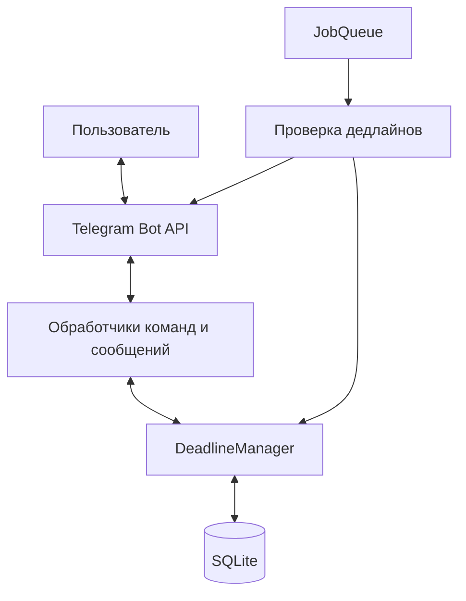
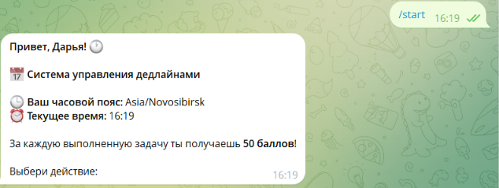
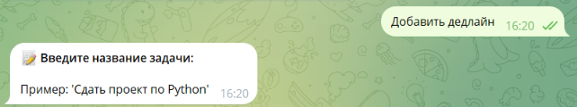
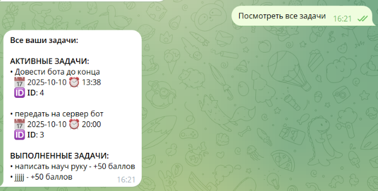
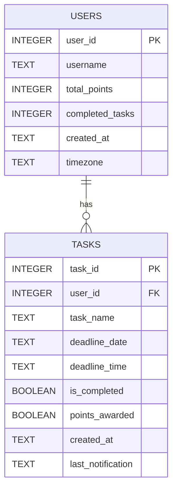

# Telegram Task Manager

Telegram-бот для управления личными задачами, контроля дедлайнов и мотивации с помощью системы достижений.

## О проекте

Deadline Cat помогает планировать задачи, отслеживать сроки и получать уведомления о просроченных дедлайнах. За своевременное выполнение задач начисляются баллы, открывающие новые уровни достижений.

## Возможности

- Создание задач с датой и временем дедлайна.
- Просмотр активных и завершённых задач.
- Отметка задач как выполненных и просмотр статистики.
- Фоновая проверка дедлайнов и отправка уведомлений.
- Выбор индивидуального часового пояса.
- Шесть уровней достижений с изображениями котиков.
- Интерактивное меню в личном чате и поддержка команд в группах.
- Постоянное хранение данных в SQLite.

## Технологический стек

| Компонент | Технологии |
|---|---|
| Backend | Python, python-telegram-bot |
| Обработка событий | async / await, long polling |
| База данных | SQLite, SQL |
| Фоновые задачи | JobQueue, APScheduler |
| Часовые пояса | pytz |
| Конфигурация | python-dotenv, переменные окружения |
| Логирование | logging |
| Контроль версий | Git, GitHub |

## Архитектура



`DeadlineManager` отвечает за операции с пользователями и задачами. Обработчики Telegram реализуют пользовательские сценарии, а JobQueue запускает проверку просроченных задач каждые 60 секунд. При отправке уведомления сохраняется время последнего оповещения.

## Команды

| Команда | Назначение |
|---|---|
| `/start` | Запуск бота |
| `/help` | Справка |
| `/add_deadline` | Добавление дедлайна |
| `/my_tasks` | Просмотр задач |
| `/my_stats` | Просмотр статистики |

## Система достижений

За своевременно выполненную задачу начисляется 50 баллов.

| Уровень | Баллы |
|---|---:|
| Малыш-Котик | 0 |
| Начинающий Котик | 250 |
| Уверенный Котик | 500 |
| Продвинутый Котик | 750 |
| Супер-Котик | 1000 |
| Котик-Легенда | 1500 |

<table>
<tr>
<td align="center"><br>0 баллов</td>
<td align="center"><br>250 баллов</td>
<td align="center"><br>500 баллов</td>
</tr>
<tr>
<td align="center"><br>750 баллов</td>
<td align="center"><br>1000 баллов</td>
<td align="center"><br>1500 баллов</td>
</tr>
</table>


## Демонстрация работы

| Главное меню | Добавление задачи | Список задач |
|---|---|---|
|  |  |  |


## База данных

При запуске автоматически создаются таблицы `users` и `tasks`. Пользователь может иметь несколько задач.



## Структура проекта

```text
TG_Bot/
├── assets/
│   └── cats/           # Изображения достижений
├── bot.py              # Логика приложения
├── requirements.txt    # Зависимости
├── runtime.txt         # Версия Python
├── Procfile            # Запуск worker
├── .env.example        # Пример конфигурации
├── .gitignore
└── README.md
```